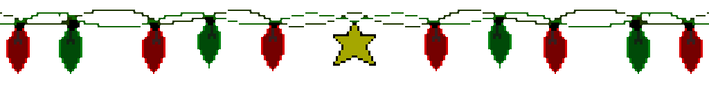

  

# Hi, I'm Robert! 👋

I'm a Computer Science student at **Kennesaw State University** interested in software engineering, artificial intelligence, robotics, and embedded systems.

I enjoy exploring new technologies, building projects, and finding opportunities to apply what I've learned.

### Currently Working On
- **[NeuroSig](https://github.com/TachyonLover/neurosig)** — A web application for analyzing EEG signal data using React and FastAPI.
- Exploring new software projects and collaborating with other developers.

### Currently Learning
- **Machine Learning** — Building a stronger foundation in mathematics and ML concepts.
- **Full-Stack Development** — Improving my skills with APIs, databases, and modern web technologies.
- **Cloud Computing** — Learning AWS and cloud infrastructure.

### Tech

